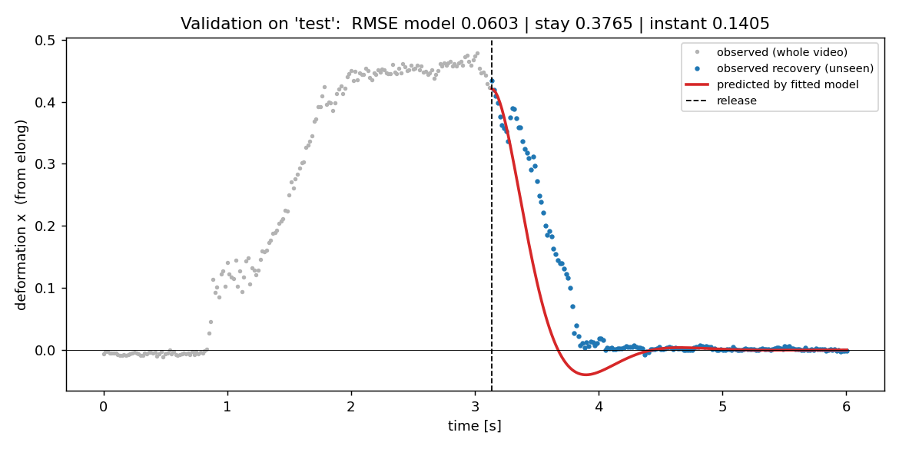
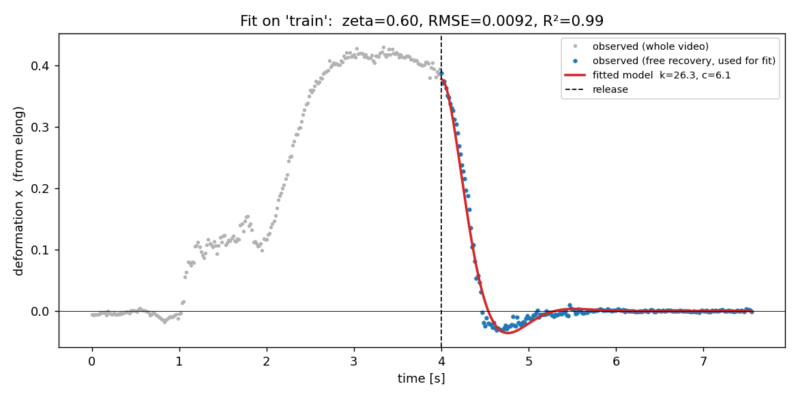

# Learning a deformable object from video: stress ball

A yellow foam stress ball is filmed while it is squeezed, held and released. OpenCV tracks how elongated its outline is. A 1-DOF spring-mass-damper is fitted to the recovery after release in one video, and then **predicts the recovery in a second, unseen press**, filmed from a different viewpoint. The model drives a deformable 3D box proxy in PyBullet.

| | Training press | Unseen test press |
|---|---|---|
| Fit / prediction R² | **0.99** | **0.77** |
| RMSE (strain) | 0.009 | 0.060 (baselines: 0.141 / 0.376) |



Demo videos (real video | PyBullet proxy | curves): [`results/demo_test.mp4`](results/demo_test.mp4), [`results/demo_train.mp4`](results/demo_train.mp4)

## Repository layout

```
├── papers/          
├── data/
│   ├── videos/      press_train.mp4 (fit), press_test.mp4 (validation)
│   └── tracks/      per-frame CSVs + tracking overlay videos (generated)
├── src/             code, run in order
├── results/         params.json, plots, 
└── requirements.txt
```

## How to run

```bash
pip install -r requirements.txt

python src/track.py train          
python src/fit.py                 
python src/track.py test           
python src/validate.py            
python src/make_demo.py --name test   
python src/proxy.py                
```


## Data

Both videos were filmed with a phone at 3840×2160 and 60 fps. The same ball is used in both.

| Video | View | Frames | What happens |
|---|---|---|---|
| `press_train.mp4` | side-on, ball on a table | 454 (7.6 s) | squeeze from the sides, hold ~1.5 s, open the fingers |
| `press_test.mp4` | top-down, ball on a board | 361 (6.0 s) | squeeze, hold ~1 s, open the fingers |

## Approach

1. **Observation (OpenCV, `track.py`).** Frames are downscaled to 1280 px wide, then an HSV threshold on yellow, morphological open/close, and the largest contour. An ellipse is fitted to the contour (`cv2.fitEllipse`), and the signal is **elongation = minor axis / major axis**. This signal is
   - *scale-invariant*: distance and zoom don't matter, and
   - *rotation-invariant*: it works for the side view and the top view and for any squeeze direction, which is why the test video could be filmed from a different angle.
2. **State (`dynamics.py`).** Deformation `x = (e_rest − e) / e_rest`, where `e_rest` is the median of the last 15 frames. `x = 0` is rest and `x ≈ 0.4` is fully squeezed.
3. **Release frame.** This is the end of the hold, where the fingers start to open, detected automatically as the last frame where the smoothed `x` is still ≥ 90 % of its peak (train: frame 240, test: frame 188).
4. **Model (`dynamics.py`).** `m ẍ = −k x − c ẋ` after release, integrated with explicit Euler (`v += (F/m)·dt; x += v·dt`) with automatic sub-stepping so that every `(k, c)` the optimiser tries stays stable. Initial condition: `x0` = observed deformation at release, `v0 = 0` (the ball is held still).
5. **Fitting (`fit.py`).** Minimise the MSE between simulated and observed `x(t)` after release. First a 40×40 log-spaced grid over `(k, c)`, then `scipy.optimize.minimize` (Nelder-Mead). Gradient-based L-BFGS got stuck in flat valleys of this loss.
6. **Validation (`validate.py`).** On the unseen press, only `e_rest` and `x0` are read from the new video. `k` and `c` are frozen from training, so the predicted curve is a **prediction, not a replay**. It is compared with two trivial baselines: *stays deformed* (`x = x0`) and *snaps back instantly* (`x = 0`).
7. **3D proxy (`proxy.py`).** A PyBullet box mesh with 8 corners, deformed volume-preservingly by `x`: `sz = (1−x)^(2/3)`, `sx = sy = 1/√sz`. Its height/width ratio is therefore exactly `1 − x`. Rendered headless with TinyRenderer for the demo (`make_demo.py`).

## Results

### Fitted parameters (`results/params.json`)

| | value |
|---|---|
| k / m | 26.3 s⁻² |
| c / m | 6.14 s⁻¹ |
| natural frequency ωₙ | 5.13 rad/s (≈ 0.8 Hz) |
| damping ratio ζ | 0.60 (under-damped) |
| train RMSE / R² | 0.0092 / 0.989 |



The model captures the fast drop **and** the small undershoot (the ball briefly goes past round, `x < 0`, then settles), which is what you'd expect from ζ ≈ 0.6.

### Prediction on the unseen press (`results/validation.json`)

| | model | baseline "stay" | baseline "instant" |
|---|---|---|---|
| RMSE | **0.060** | 0.376 | 0.141 |
| R² | **0.77** | – | – |
| time to 50 % recovery | 0.27 s predicted vs **0.43 s observed** | | |

The model predicts the unseen recovery about **2.3× better than the best trivial baseline**. The main errors are:
- **It predicts recovery ~0.15 s too fast.** In the test video, the fingers open more slowly and pause briefly (the bump at ~3.3 s). Because the fitted k and c also contain the hand's opening speed (see Assumptions), a slower release looks like a "softer" ball.
- **It predicts an undershoot that the test video does not show.** In the side-on training view, the undershoot is the ball bulging upward/sideways after the release. From the top-down test view this mode is mostly not visible. A single 2D silhouette measure is view-dependent.

## Assumptions

- The ball's shape can be summarised by **one number** (silhouette elongation), and this number follows a **linear second-order ODE** after release.
- **The fitted k and c are effective parameters of the "release" interaction.** The fingers open over ~0.3 s while the ball springs back, and a single camera cannot separate the two. If the fit instead starts only when the thumb has fully separated (train ≈ frame 265), just ~5 % deformation is left, which is too little signal to fit.
- **Mass is not observable** from video. Only `k/m` and `c/m` are identifiable, so `m = 1`.
- `v0 = 0` at release (the ball is held still at the end of the hold).
- The ball reaches its rest shape by the end of each video (it is the reference `e_rest`).

## What the model can and cannot capture

**Can:** the time scale, damping and slight overshoot of the shape recovery, predicted for a new squeeze (even filmed from another angle) from only its initial deformation.

**Cannot:**
- **The loading phase.** The hand's force is not modelled, so the model cannot say how much the ball deforms for a given squeeze, only how it recovers.
- **Nonlinear / viscoelastic foam behaviour.** There is one spring and one damper, so one time scale. Foam typically has fast elastic and slow creep components, and the stiffness grows with compression.
- **Local shape.** Finger dents and asymmetric bulges are reduced to one ellipse ratio. A box proxy cannot show them.
- **Absolute physical units.** Without a force sensor or known mass, there is no k in N/m. With one camera, there is no true 3D shape.
- **View dependence.** The silhouette measure changes with the viewpoint (see the missing undershoot in the top-down test).

**Possible improvements:** fit only after the thumb fully separates using a higher-fps camera; a second camera or a depth sensor; a nonlinear spring `k(x)` or a two-time-scale (standard linear solid) model; fitting several presses jointly.

## Tools and credits

- [OpenCV](https://opencv.org/): video I/O, colour segmentation, contours, ellipse fit, demo rendering
- [NumPy](https://numpy.org/), [pandas](https://pandas.pydata.org/): data handling
- [SciPy](https://scipy.org/): `scipy.optimize.minimize` (Nelder-Mead)
- [PyBullet](https://pybullet.org/): 3D box proxy and headless TinyRenderer
- [Matplotlib](https://matplotlib.org/): plots
- Code written with the help ofLLMs.
